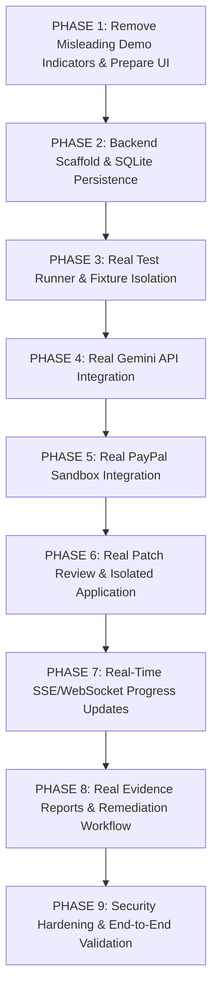

# IntegrateIQ: Real-Time Conversion Audit & Migration Blueprint

**Document Version:** 1.0.0  
**Date:** November 12, 2026  
**Status:** In Progress (Active Migration)  
**Author:** IntegrateIQ Engineering Team  

---

## 1. Executive Summary

IntegrateIQ was initially built as a high-fidelity frontend prototype designed for mentor demonstration. While the UI adhered to high design standards (Linear/Vercel dark technical dashboard aesthetic), the operational mechanics relied entirely on simulated state mutations, artificial delays (`setTimeout`), and hardcoded fixtures.

This audit establishes the baseline of existing demo-mode mechanisms, identifies architectural gaps, and specifies the migration path to a **genuine full-stack, real-time, API-connected debugging and verification platform**.

---

## 2. Inventory of Current Demo Behaviour

| Subsystem | Current Prototype Behaviour | Real-World Required Behaviour |
| :--- | :--- | :--- |
| **Backend & Persistence** | Browser in-memory React state (`useState`), resets on page reload. Initialized from `mockSessionData.ts` and `mockReportData.ts`. | FastAPI backend with persistent SQLite database (`integrateiq.db`) storing sessions, failure events, diagnoses, patches, test executions, reports, remediation items, and audit trails. |
| **Failure Reproduction** | `setTimeout(1300)` simulating incoming webhook event, setting hardcoded payload from `SCENARIO_TEMPLATES`. | Subprocess invocation of Pytest executing actual test suites against an isolated copy of the target fixture, capturing process exit code, stdout, stderr, and failed assertions. |
| **AI Diagnosis** | `setTimeout(1500)` loading predefined text from `mockSessionData.ts` claiming 94.2% confidence. | Real call to Google Gemini API (`gemini-2.5-flash` / `gemini-1.5-flash` / `gemini-3.8-flash` via official `google-genai` Python SDK) passing actual error logs, stack traces, and code context. Honest error handling for quota/auth failures. |
| **Patch Proposal** | Predefined diff in `mockSessionData.ts` with static lines added/removed. | Real unified diff generated by Gemini (or selected from validated catalog), validated for path traversal and syntax, and isolated to allowlisted fixture files. |
| **Patch Application** | State transition `PATCH_APPROVED` without modifying any file system files. | Isolated working copy creation; unified diff applied using Python `patch` or diff applier; SHA-256 source digests calculated before and after. |
| **Test Execution** | `setTimeout` loop updating progress (15% -> 45% -> 80% -> 100%) and returning hardcoded 4/4 pass. | Real subprocess test execution (`pytest -v --tb=short`) running in an isolated sandbox with timeouts, process isolation, and genuine stdout/stderr capture. |
| **PayPal Sandbox** | "Test Connection" button modal stating "External connections are not implemented in this prototype". | Real OAuth 2.0 token acquisition (`POST /v1/oauth2/token`) against `api-m.sandbox.paypal.com` and genuine webhook signature verification (`POST /v1/notifications/verify-webhook-signature`). |
| **Verification Reports** | Static mock reports generated client-side with disclaimer badges. | Persistent, evidence-backed reports created from actual test results, exit codes, and diff digests, with JSON and HTML export endpoints. |
| **Dashboard Metrics** | Computed in-memory from mock session list. | Live database aggregation (`GET /api/dashboard/summary`) with real-time SSE/WebSocket broadcast on state mutations. |

---

## 3. Existing Real Assets & Usable Foundations

1. **Frontend UI Shell:** All 8 primary pages, layout components (`Sidebar`, `TopBar`, `CommandPalette`), navigation, metric cards, status badges, and code diff viewers are high quality and will be preserved.
2. **TypeScript Domain Models:** `src/types/index.ts` has typed models for sessions, reports, remediation actions, and test results that map directly to Pydantic backend models.
3. **Python Runtime & Dependencies:** Python 3.12 is installed locally with `fastapi`, `uvicorn`, `google-genai`, `pytest`, `httpx`, `requests`, `aiosqlite`, `pydantic`, `cryptography`, and `python-dotenv` already present in the environment.
4. **Vite Toolchain:** Vite 6 + React 18 running on port 3000, capable of reverse-proxying `/api` and `/ws` to FastAPI on port 8000.

---

## 4. Phase-by-Phase Migration Plan



### Phase Details

1. **Phase 1: Remove Misleading Demo Behaviour & Prepare UI**
   - Configure Vite proxy to route `/api` to `http://localhost:8000`.
   - Update frontend labels: replace "SIMULATED RESULTS" with explicit indicators:
     - `OFFLINE CONTRACT TEST` (for deterministic pytest fixture runs)
     - `PAYPAL SANDBOX INTEGRATION TEST` (for live PayPal gateway requests)
     - `LIVE GEMINI API` (for real GenAI calls)
     - `CONFIGURATION REQUIRED` (when credentials are unset)

2. **Phase 2: FastAPI Backend & SQLite Database**
   - Create `backend/` directory structure.
   - Setup SQLite database (`integrateiq.db`) with tables:
     - `sessions`: id, scenario_id, status, created_at, updated_at, reproduction_data, diagnosis_data, patch_data, verification_data, test_cases_json.
     - `reports`: id, session_id, category, severity, title, content_json, created_at.
     - `remediation_actions`: id, report_id, title, description, priority, status, source_type, reason, developer_notes, completed_at.
     - `audit_events`: id, session_id, event_type, details_json, created_at.
   - Seed database with existing scenario definitions and realistic baseline historical data so navigation is never empty.

3. **Phase 3: Real Test Runner & Fixture Isolation**
   - Build a Python test fixture for PayPal Webhook Signature Verification (`backend/fixtures/webhook_receiver/`).
   - Create broken version (`verifier.py`) with:
     - Outdated fallback webhook ID.
     - Re-serialized JSON payload breaking cryptographic hash.
   - Create Pytest test suite (`test_webhook_contract.py`) containing 4 real test cases.
   - Implement `test_runner_service.py` to create isolated temp directories, copy fixtures, execute `pytest` via `subprocess.run()`, parse JSON/short test report output, and record real duration, stdout, stderr, and exit codes.

4. **Phase 4: Real Gemini API Integration**
   - Implement `backend/app/services/gemini_service.py` using `google.genai.Client`.
   - Implement health check to verify model availability.
   - Construct structured prompts providing actual source code snippet, error message, and test failure output.
   - Generate structured JSON diagnosis and unified diff patch proposals.
   - Handle quota exhaustion, invalid API key, and network timeout with clear, actionable UI error messages.

5. **Phase 5: Real PayPal Sandbox Integration**
   - Implement `backend/app/services/paypal_service.py`.
   - Implement OAuth token acquisition against `https://api-m.sandbox.paypal.com/v1/oauth2/token`.
   - Cache access tokens according to `expires_in`.
   - Implement webhook signature verification against `https://api-m.sandbox.paypal.com/v1/notifications/verify-webhook-signature`.
   - Implement genuine connection check endpoint returning `CONNECTED`, `DISCONNECTED`, `CONFIGURATION REQUIRED`, or `CONNECTION ERROR`.

6. **Phase 6: Real Patch Review & Application**
   - Implement patch validation: reject path traversal (`../`), verify unified diff syntax, restrict to allowlisted target files.
   - Implement patch application to isolated workspace without modifying source fixtures.
   - Compute SHA-256 before and after patch application.

7. **Phase 7: Real-Time SSE/WebSocket Progress Updates**
   - Implement Server-Sent Events (`/api/events/{session_id}`) or WebSocket broadcast.
   - Emit backend events for every workflow transition:
     `SESSION_CREATED` -> `REPRODUCING` -> `REPRODUCED` -> `DIAGNOSING` -> `DIAGNOSED` -> `PATCH_APPROVED` -> `VERIFYING` -> `VERIFIED`.
   - Provide automatic reconnection and REST polling fallback.

8. **Phase 8: Evidence Reports & Remediation Workflow**
   - Implement report generation engine creating records from real test executions.
   - Provide JSON and HTML download endpoints.
   - Support updating remediation action status (`NOT_STARTED`, `IN_PROGRESS`, `COMPLETED`, `BLOCKED`).

9. **Phase 9: Security Hardening & End-to-End Validation**
   - Verify no credentials in frontend bundle or logs.
   - Ensure timeout limits on subprocess execution (max 15s).
   - Prevent arbitrary command execution.
   - Test full end-to-end workflow in browser and backend pytest.

---

## 5. Security & Boundary Architecture

```
+-----------------------------------------------------------+
|                   Browser / Frontend                      |
|  - Vite + React + TypeScript                              |
|  - Zero API keys or secrets stored                        |
|  - Displays real statuses and evidence logs               |
+-----------------------------+-----------------------------+
                              | REST / SSE / WS (via Vite Proxy)
                              v
+-----------------------------------------------------------+
|                   FastAPI Backend                         |
|  - Environment variable secrets (GEMINI_API_KEY, PAYPAL)  |
|  - Secret redaction filter on all responses & logs        |
|  - Restricted CORS & parameter validation                 |
+--------------+-------------------+------------------------+
               |                   |
      +--------v-------+   +-------v--------+
      |  Google Gen AI |   | PayPal Sandbox |
      |  (Gemini API)  |   | (REST v1 / v2) |
      +----------------+   +----------------+
               |
      +--------v--------------------------------------------+
      |             Subprocess Test Runner                  |
      |  - Restricted isolated temp working copy            |
      |  - Predefined allowlisted commands (pytest only)     |
      |  - Strict execution timeout (15s)                   |
      |  - No shell=True                                    |
      |  - Captures actual stdout, stderr, exit code        |
      +-----------------------------------------------------+
```

This migration plan guarantees that every displayed result in IntegrateIQ is backed by real execution evidence.
